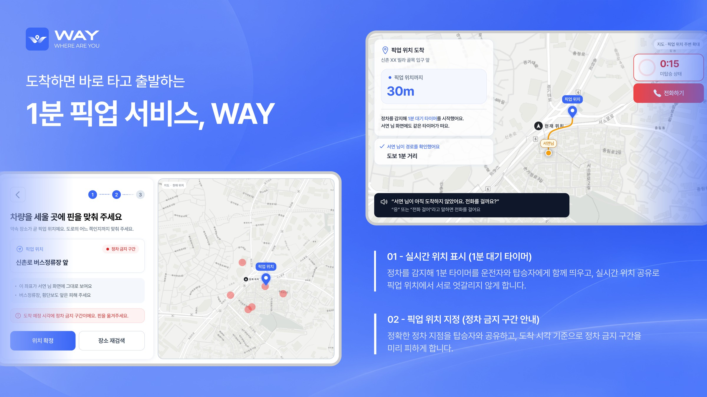
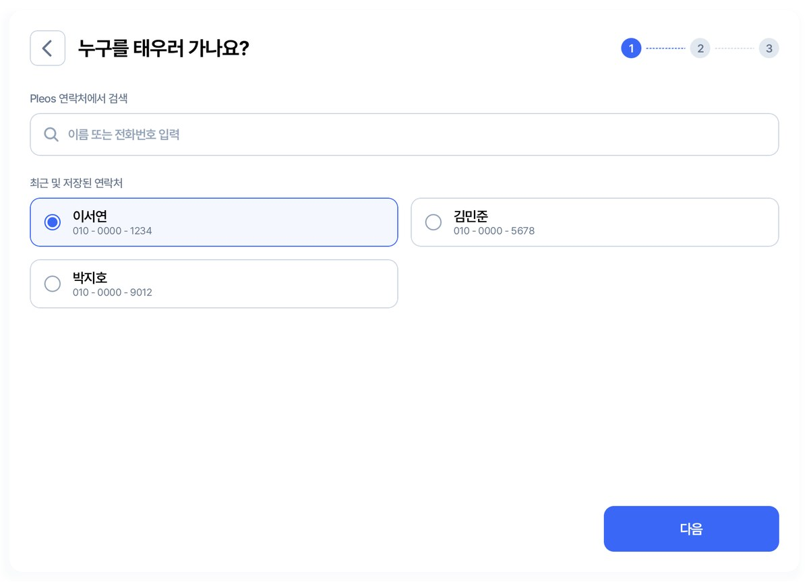
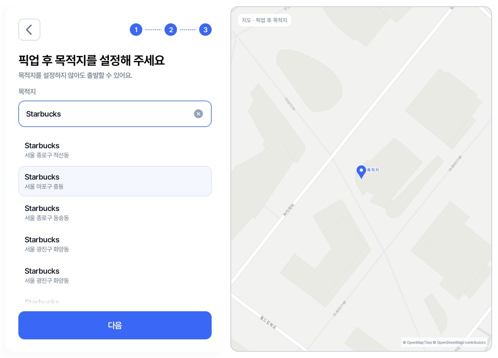
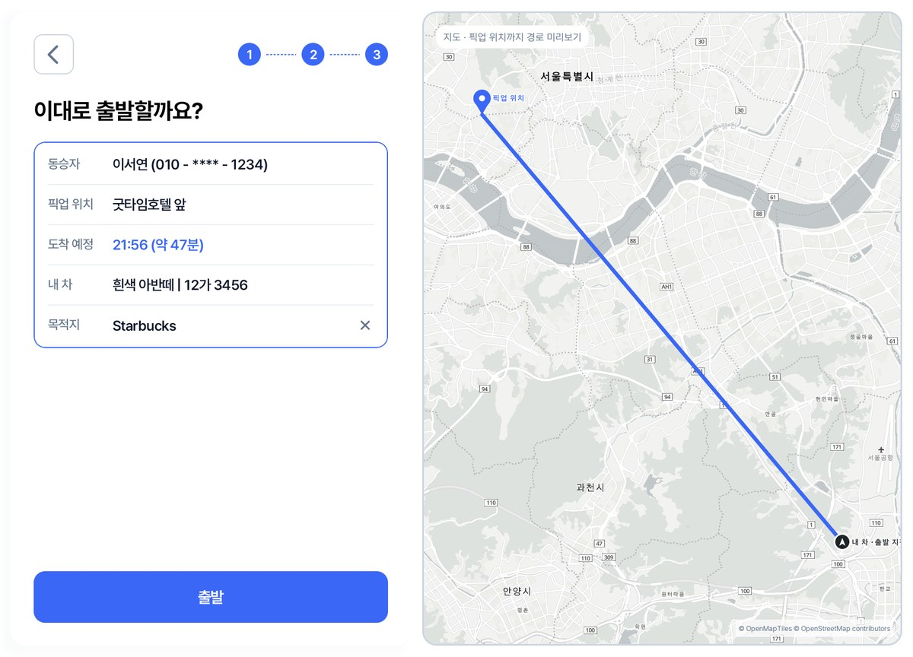
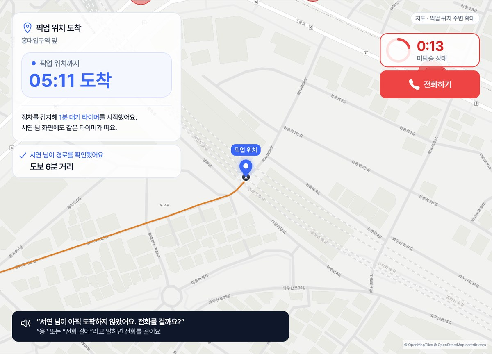
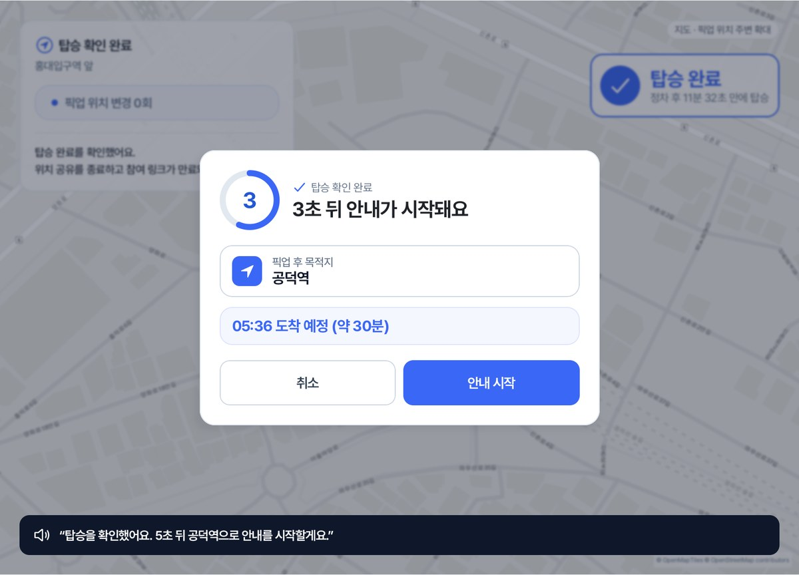
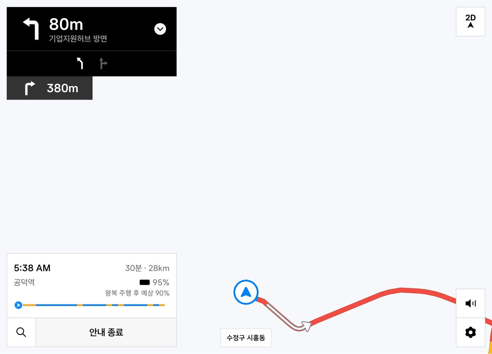
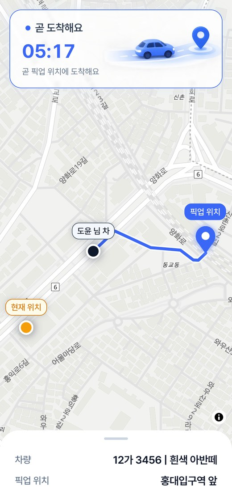
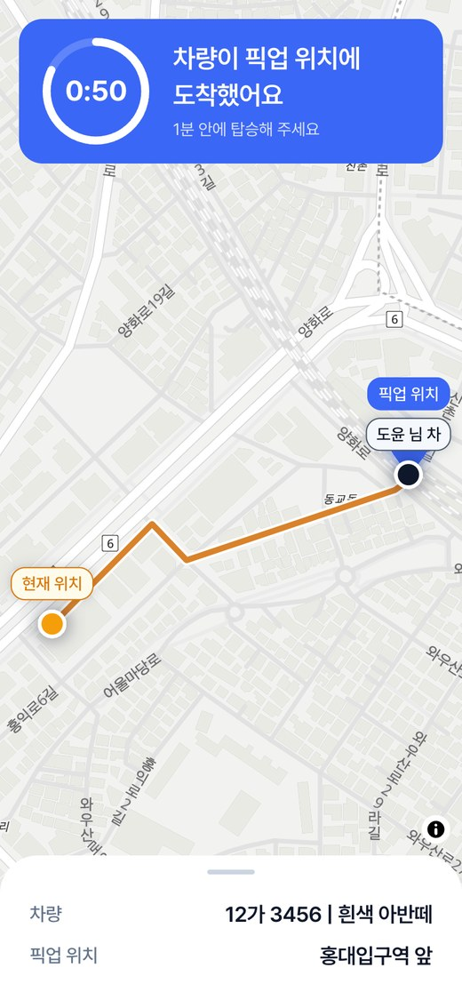
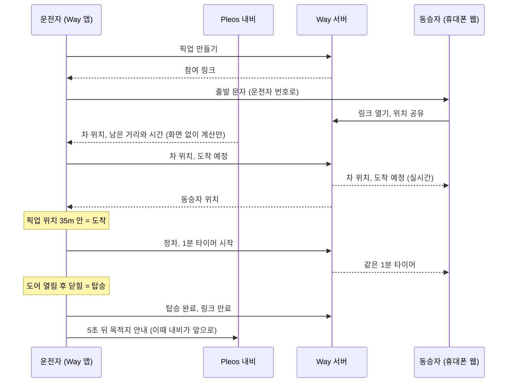

# WAY

**도착하면 바로 타고 출발하는 1분 픽업 서비스.** way-point 팀이 만든 Pleos Connect용 차량 앱으로, 현대자동차그룹 차량용 앱 개발 공모전 출품작입니다.

운전자는 차 화면에서 동승자를 태울 자리를 도로의 어느 쪽 인도인지까지 정합니다. 동승자는 문자로 받은 링크 하나로 그 자리와 다가오는 차를 봅니다.



## APK

- 파일: `way-point_way_release.apk` (release 빌드, 약 115MB)
- 위치: [GitHub Release v1.0](https://github.com/hyundai-way-team/front/releases/tag/v1.0) ([바로 받기](https://github.com/hyundai-way-team/front/releases/download/v1.0/way-point_way_release.apk))
- GitHub 저장소에 올릴 수 있는 파일 크기(100MB)를 넘어서 Release에 올렸습니다. [`apk/`](apk/) 폴더에도 같은 안내가 있습니다.

## 실행 방법

1. Pleos Connect 에뮬레이터를 켭니다(아래 [테스트 환경](#테스트-환경과-설정)).
2. APK를 설치합니다.

   ```bash
   adb install -r way-point_way_release.apk
   ```

3. 아래 바나 앱 목록에서 **Way**를 엽니다. 명령으로 열려면 다음을 실행합니다. 에뮬레이터의 앱 사용자는 10번입니다.

   ```bash
   adb shell am start --user 10 -n com.kscho.way/.MainActivity
   ```

4. 처음 열 때 알림 권한을, 동승자를 고를 때 연락처 권한을 허용합니다.
5. 픽업 만들기 → 동승자 → 약속 장소 → 핀 맞추기 → 목적지(건너뛰어도 됨) → 출발 순서로 진행합니다. 출발하면 동승자에게 링크가 담긴 문자가 나가고 주행 화면(D-06)으로 넘어갑니다.

앱은 임시 서버(`https://way.posktop.duckdns.org`)에 붙어 있어서 서버를 따로 띄우지 않아도 됩니다.

## 테스트 환경과 설정

| 항목 | 내용 |
|---|---|
| 에뮬레이터 | Pleos Connect v2.1.0 시스템 이미지(Android 14 · API 34, Automotive, arm64-v8a, 42dot), Android Emulator 37.1.11 |
| 화면 규격 | 2560 × 1440, 160dpi, 가로. Way 화면은 왼쪽 계기 영역과 위아래 바를 뺀 앱 영역(약 1680 × 1210)에 뜹니다. |
| AVD | RAM 4GB, CPU 4코어, 데이터 6GB |
| 개발 PC | macOS 26, Apple M1 · 16GB |
| 빌드 | JDK 17, Android Gradle Plugin 9.0.1, Gradle 9.1, Kotlin 2.3.20 |
| 앱 | 패키지 `com.kscho.way`, minSdk 28, targetSdk 36, ABI arm64-v8a · x86_64 |

필요한 설정입니다.

- **인터넷:** 동승자 링크, 실시간 위치, 정차 금지 구간을 임시 서버에서 받습니다. 지도와 장소 검색은 앱 안에 있어서 인터넷 없이도 됩니다.
- **권한:** 알림(헤드업 알림)과 연락처(동승자 고르기)를 허용합니다. Pleos 권한(문 상태, 내비 경로)은 매니페스트에 선언돼 있어서 따로 켤 것이 없습니다.
- **연락처:** 에뮬레이터 주소록에 동승자로 고를 연락처를 한 명 이상 넣어 둡니다.
- **문자:** 동승자 문자는 차에 블루투스로 연결된 운전자 휴대폰에서 Pleos 메시지로 나갑니다. 에뮬레이터엔 휴대폰이 없어서 출발할 때 Pleos 문자 화면이 '기기를 연결하세요'로 뜹니다. Way로 돌아오면 주행 화면이 이어집니다. 문자 내용과 동승자 링크는 `adb logcat -s WayText`로 볼 수 있습니다.
- **탑승:** 에뮬레이터 Virtual Console(`adb forward tcp:8088 tcp:8088` 뒤 http://127.0.0.1:8088)에서 앞 오른쪽 문을 열었다 닫으면 탑승으로 처리됩니다.
- **차 위치:** 에뮬레이터의 Pleos 내비 위치는 한곳(성남시 수정구 시흥동)에 고정돼 있어 실제로 달리지 않습니다. 도착과 1분 대기까지 화면으로 보려면 [소스에서 빌드하기](#소스에서-빌드하기)의 디버그 빌드에서 시연 주행(`DEMO_ROUTE`)이나 정차 명령(`ARRIVE`)을 씁니다.

## 무엇을 해결하나요

픽업할 때마다 "어디쯤이야?", "길 건너편이야?" 하는 통화가 오갑니다. WAY는 약속 장소를 핀으로 정하고, 동승자 화면에도 같은 좌표를 그대로 보여 줍니다. 차가 서면 1분 대기 타이머가 양쪽에서 함께 돕니다. 1분은 불법 주정차 단속의 예외 시간입니다. 문이 열렸다 닫히면 탑승으로 보고 픽업을 끝냅니다. 운전 중에 화면을 만질 일은 음성 안내와 헤드업 알림으로 줄였습니다.

## 픽업 한 번의 흐름

화면 이름(D-01~D-11, P-01~P-06)은 피그마 와이어프레임 v2의 프레임 이름과 같습니다. 캡처는 모두 Pleos Connect 에뮬레이터와 임시 서버에서 실제 데이터로 찍었습니다. 연락처와 차량 번호만 시연용 값입니다. 에뮬레이터의 차 위치는 한곳에 고정돼 있어서, 주행 장면은 디버그 빌드의 시연 주행(실제 차도 경로를 빠르게 달림)으로 찍었습니다.

### 출발 전

| D-01 홈 | D-02 누구를 태우러 가나요 |
|---|---|
|  |  |
| 최근 픽업을 누르면 같은 사람, 같은 장소로 바로 이어집니다. | 기기 연락처에서 고르며, 최근에 태운 사람이 먼저 나옵니다. |

| D-03 약속 장소 | D-04 핀 맞추기 |
|---|---|
|  |  |
| 앱 안에 넣은 장소 색인으로 찾습니다. 인터넷 지도 API를 부르지 않습니다. | 지도를 움직여 핀을 정차할 자리에 맞춥니다. 버스정류장 둘레나 지정 주정차 금지구역에 걸리면 정차 금지 구간이라고 알려 줍니다. 정차 금지 구간은 핀 둘레 300m만 그립니다(홈 지도엔 그리지 않습니다). |

| D-05 픽업 후 목적지 | D-05 출발 확인 |
|---|---|
|  |  |
| 건너뛰어도 됩니다. 정해 두면 탑승한 뒤 그곳으로 안내합니다. | 동승자 번호는 가운데를 가립니다. 출발을 누르면 Way 주행 화면으로 넘어가고 동승자에게 문자가 갑니다. |

### 가는 길


출발해도 Way 화면이 그대로 앞에 있습니다. Pleos 내비로는 탑승한 뒤에야 넘어갑니다. 왼쪽 위 카드의 앞 글자는 5초마다 '픽업 위치까지 N분'과 '도착 예정 시간'을 번갈아 보여 주고, 그 옆 남은 거리는 그대로 있습니다. 남은 길은 Pleos 내비에 화면 없이 계산만 맡겨 15초마다 새로 받고, 차 위치는 3초마다 묻습니다. 지도는 차를 카드 오른쪽 가운데에 두고, 카드의 남은 거리가 500m 이하가 되면 한 번 확대합니다. 정차 금지 구간은 픽업 위치 둘레 300m만 그립니다. 지도는 손으로 옮기거나 확대해 볼 수 있고, 손을 뗀 지 10초가 지나면 다시 차를 따라갑니다. 아래 네 단계는 일이 일어날 때마다 완료로 바뀝니다.

동승자에게 가는 문자는 세 가지입니다. 출발할 때, 도착 5분 전, 도착 예정이 3분 넘게 바뀌었을 때입니다. 세 문자 모두 차에서 운전자 번호로 보냅니다(Pleos 메시지, 블루투스로 연결된 휴대폰). 서버는 동승자 번호를 받지 않습니다.

### 도착해서

| D-08 정차, 1분 대기 | D-09 15초 남았는데 아직 안 탐 |
|---|---|
|  |  |
| 픽업 위치 35m 안에 들어오면 도착으로 보고 타이머가 시작됩니다. 동승자가 위치를 공유했으면 걸어올 길(주황 선)과 도보 거리가 보입니다. | "전화를 걸까요?" 하고 물어 '응'이라고 답하면 전화를 겁니다. 손으로 누르는 전화하기 버튼도 있습니다. |

| D-11 탑승, 다음 목적지 연결 | 5초 뒤 |
|---|---|
|  |  |
| 앞 오른쪽 문이 열렸다 닫히면 탑승으로 봅니다. 5초를 센 뒤 정해 둔 목적지 안내를 Pleos 내비에 넘깁니다. '안내 시작'을 누르면 바로 넘어가고, '취소'를 누르면 D-10 탑승 완료 화면에 남습니다. | 이때 처음으로 Pleos 내비가 앞으로 나와 목적지까지 안내합니다. 목적지가 없으면 기본 내비 화면을 엽니다. |

### 동승자 화면

동승자는 문자 속 링크를 엽니다. 설치도 로그인도 없이 휴대폰 브라우저에서 끝납니다.

<table>
  <tr>
    <td width="20%"></td>
    <td width="20%"></td>
    <td width="20%"></td>
    <td width="20%"></td>
    <td width="20%"></td>
  </tr>
  <tr>
    <td>P-01. 누가 언제 오는지, 어떤 차를 타는지, 어디서 기다리는지 봅니다.</td>
    <td>P-02. 위치를 공유할지 고릅니다. 허용하지 않아도 차 위치와 도착 예정 시각은 보입니다.</td>
    <td>P-04. 차와 내 위치를 함께 봅니다. 차가 오는 길은 파란 선입니다. 아래 시트를 끌어 올리면 경로 안내가 나옵니다.</td>
    <td>P-05. 차가 서면 차 화면과 같은 1분 타이머가 뜨고, 걸어갈 길이 주황 선으로 나옵니다. 시간이 줄수록 카드가 파랑에서 빨강으로 바뀝니다.</td>
    <td>P-06. 타면 위치 공유가 끝나고 링크는 만료됩니다.</td>
  </tr>
</table>

## 어떻게 이어지나요



정해 둔 것들입니다.

- **지도와 장소 검색은 앱 안에 둡니다.** 공모전에서 쓸 수 있는 Pleos SDK에 지도가 없어서 MapLibre에 오프라인 지도 파일(OpenStreetMap, `app/src/main/assets/map/way.pmtiles`)과 오프라인 장소 색인(`assets/places/way-places.dat`)을 넣었습니다. 실행 중 외부 지도 API를 부르지 않습니다. Pleos 내비게이션 SDK가 열리면 그쪽으로 옮길 계획입니다.
- **정차 금지 구간은 공공데이터로 판단합니다.** 국토교통부 전국 버스정류장 위치정보에서 수도권 74,726곳을 뽑아 정류장 둘레 10m를 금지 구간으로 봅니다. 지정 주정차 금지구역은 행정안전부 표준데이터(수도권 10,264곳)를 씁니다. 이 데이터엔 좌표가 없고 '○○약국 앞 ~ ○○사거리' 같은 글만 있어서, 서버가 그때그때 카카오 로컬 API로 두 끝을 찾고 그 사이를 OpenStreetMap 도로 선을 따라 잘라 냅니다. 카카오 정책에 따라 찾은 결과는 저장하지 않습니다. 서버가 구간을 내려 주고, 도착 예정 시각 기준의 판단은 앱이 합니다.
- **탑승은 도어 센서로 판정합니다.** Vehicle SDK로 앞 오른쪽 문이 열렸다 닫히는 것을 봅니다. 도어 정보를 쓸 수 없으면 화면 버튼이나 Gleo에게 "탑승 완료"라고 말해서 알립니다.
- **동승자 지도의 길은 공개 경로 서버로 찾습니다.** Pleos 내비는 남은 거리와 시간만 주고 경로 모양은 주지 않습니다. 그래서 서버가 차 위치(차 길, 파란 선)와 동승자 위치(걷는 길, 주황 선)에서 픽업 위치까지의 길을 무료 공개 OSRM(FOSSGIS `routing.openstreetmap.de`, OpenStreetMap)에 묻습니다. 좌표 두 점만 보내고, 차 길은 차가 길에서 40m 넘게 벗어날 때만 10초에 한 번까지 다시 묻습니다.
- **픽업까지는 Way 화면이 앞에 있습니다.** Pleos 내비는 경로를 걸면(requestRoute) 화면 앞으로 나와 다른 앱을 가립니다. 그래서 픽업 구간에는 경로를 걸지 않고, 화면 없는 길 계산(requestTrip)과 차 위치만 묻습니다. 탑승 뒤 5초가 지나거나 운전자가 버튼을 누르면 그때 목적지를 내비에 넘기고 내비가 앞으로 나옵니다. 픽업 구간에는 내비의 회전 안내가 없습니다.

## 구조

클린 아키텍처로 나눴습니다. 화면은 domain 의 UseCase 만 보고, 구현(서버·기기 연동)은 Hilt 가 주입합니다.

```
presentation ─▶ domain ◀─ data ◀─ data:device
      ▲                              ▲
      └────────────── app ───────────┘
```

| 모듈 | 하는 일 |
|---|---|
| `:domain` | 순수 Kotlin. 기능별 `model`·`repository`·`usecase`, 바깥 장치 인터페이스(`gateway`: 내비, 도어, 문자, 시계), 픽업 규칙(`PickupRules`)과 픽업 진행(`PickupCoordinator`), 결과 타입 `ApiState` |
| `:data` | 순수 Kotlin. Retrofit `WayApi`, `request`·`response`·`mapper`, 원격·로컬 데이터 소스(동승자 상태 WebSocket, 지난 픽업 파일, 오프라인 장소 색인), 저장소 구현, 서버 없이 쓰는 `fake` |
| `:data:device` | Android. Pleos SDK 연동(내비 `PleosNavigator`, 도어 `PleosBoardingSensor`, 문자 `PleosMessenger`), 기기 연락처, 내 차 정보 |
| `:presentation:component` | 테마, 공용 컴포넌트, `BaseViewModel<UiState, UiEvent>` |
| `:presentation:map` | MapLibre 오프라인 지도(`WayMap`)와 마커 |
| `:presentation:home` · `:plan` · `:drive` | 화면별 `ViewModel`·`Route`·`Screen`. 홈(D-01), 출발 전(D-02~D-05), 주행·대기·탑승(D-06~D-11) |
| `:presentation` | 화면 이동(Navigation3) |
| `:app` | `Application`, `MainActivity`, Hilt 모듈(`di`), 포그라운드 서비스와 음성 안내, Gleo |
| `:server` | Ktor 임시 서버. 픽업 세션과 참여 링크, 차와 동승자 웹을 잇는 WebSocket, 동승자 웹(`/p/{token}`), 정차 금지 구간 API |

## 소스에서 빌드하기

JDK 17과 Pleos Connect 에뮬레이터가 필요합니다. 에뮬레이터의 앱 사용자는 10번이라 `adb` 명령에 `--user 10`을 붙입니다.

```bash
./gradlew :app:assembleDebug
```

```bash
adb install -r app/build/outputs/apk/debug/app-debug.apk
```

릴리스 APK는 `./gradlew :app:assembleRelease`로 만듭니다. 릴리스 빌드에는 아래 디버그 명령과 시연 주행이 들어가지 않습니다. 저장소엔 서명 설정이 없어서 `app-release-unsigned.apk`가 나오고, Release의 `way-point_way_release.apk`는 이것을 `apksigner`로 서명한 것입니다.

16GB 맥에서 에뮬레이터를 켠 채 Gradle 데몬으로 빌드하면 에뮬레이터가 죽을 수 있습니다. 그럴 땐 `--no-daemon -Pkotlin.compiler.execution.strategy=in-process`를 붙입니다.

시연할 때 쓰는 스위치는 `app/src/main/java/com/kscho/way/di/WayConfig.kt`에 있습니다.

| 값 | 뜻 |
|---|---|
| `SERVER_URL` | Way 서버 주소. 지금은 임시 서버 `https://way.posktop.duckdns.org`, 로컬 서버는 `http://10.0.2.2:8080`, `null`이면 앱 안 가짜 서버(`FakeWayApi`) |
| `SIMULATED_DRIVE` | `true`면 Pleos 내비 대신 20배속 모의 주행이라 D-06~D-10이 Way 화면에 그대로 보입니다 |
| `TEXTS_VIA_PLEOS` | `false`면 문자 화면을 띄우지 않고 로그(`WayText`)만 남깁니다. 휴대폰을 연결할 수 없는 에뮬레이터에서 화면을 녹화할 때 씁니다 |
| `DEMO_HISTORY` | `true`면 처음 설치할 때 지난 픽업 두 건을 넣어 둡니다 |

디버그 빌드에서는 화면을 거치지 않고 픽업을 움직일 수 있습니다.

```bash
adb shell am broadcast --user 10 -a com.kscho.way.debug.START_MOCK_PICKUP -p com.kscho.way
```

```bash
adb shell am broadcast --user 10 -a com.kscho.way.debug.ARRIVE -p com.kscho.way
```

```bash
adb shell am broadcast --user 10 -a com.kscho.way.debug.BOARD -p com.kscho.way
```

```bash
adb shell am broadcast --user 10 -a com.kscho.way.debug.CLEAR_PICKUP -p com.kscho.way
```

차례대로 출발, 정차, 탑승, 픽업 지우기입니다. 에뮬레이터의 차 위치는 한곳에 고정돼 있어서, 주행 장면은 `DEMO_ROUTE`로 실제 차도 경로(`위도,경도;…`)를 빠르게 달리게 해 봅니다. 쓰는 법은 `app/src/debug/java/com/kscho/way/debug/DebugPickupReceiver.kt` 주석에 있습니다. 실제 도어로 시험하려면 에뮬레이터 Virtual Console(`adb forward tcp:8088 tcp:8088` 뒤 http://127.0.0.1:8088)에서 앞 오른쪽 문을 열었다 닫습니다.

### 서버

```bash
./gradlew :server:installDist
```

```bash
WAY_MAP_DIR=app/src/main/assets/map server/build/install/server/bin/server
```

`WAY_MAP_DIR`는 동승자 웹이 앱과 같은 오프라인 지도를 쓰게 합니다. 서버는 8080 포트로 뜨며, 앱의 `SERVER_URL`을 `http://10.0.2.2:8080`으로 바꾸면 에뮬레이터 앱이 붙습니다. 동승자 웹 주소 끝에 `?demo`를 붙이면 휴대폰 없이 가상 위치로 걸어오는 동승자를 흉내 냅니다. 운영에서는 `WAY_DEV_ROUTES=0`으로 개발용 경로를 끕니다. 임시 서버에 올리는 방법은 [deploy/lightsail/README.md](deploy/lightsail/README.md)에 있습니다.

### 테스트

```bash
./gradlew :domain:test :data:test :data:device:testDebugUnitTest :presentation:map:testDebugUnitTest :presentation:drive:testDebugUnitTest :app:testDebugUnitTest :server:test
```

## 데이터와 라이선스

- 지도: © OpenMapTiles © OpenStreetMap contributors (ODbL). 타일은 OpenFreeMap에서 한 번 받아 `tools/map/build_offline_map.py`로 만듭니다.
- 장소 색인: OpenStreetMap, `tools/map/build_places_index.py`
- 버스정류장: 국토교통부 전국 버스정류장 위치정보(공공데이터포털 15067528, 이용허락범위 제한 없음), `tools/data/build_bus_stops.py`
- 지정 주정차 금지구역: 전국주정차금지(지정)구역표준데이터(공공데이터포털 15034542)와 그 도로의 OpenStreetMap 선, `tools/data/build_no_parking_zones.py`. 구역 끝 위치는 카카오 로컬 API로 그때그때 찾습니다.
- 길 찾기: FOSSGIS 공개 OSRM(`routing.openstreetmap.de`, OpenStreetMap)
- 글꼴: Pretendard (SIL Open Font License, `app/src/main/assets/licenses/Pretendard-OFL.txt`)
- 지도 그리기: MapLibre Native Android, MapLibre GL JS
