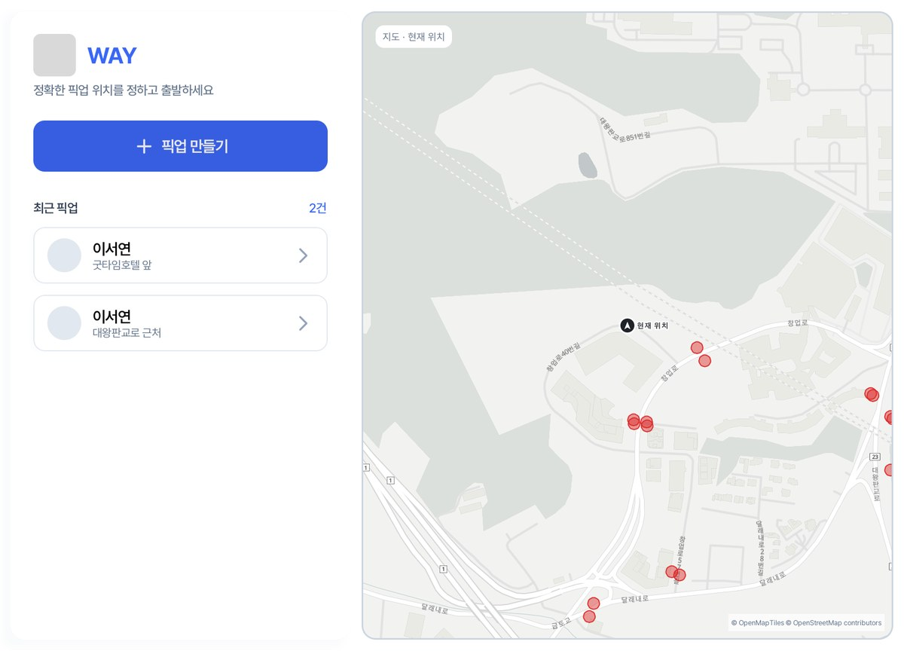
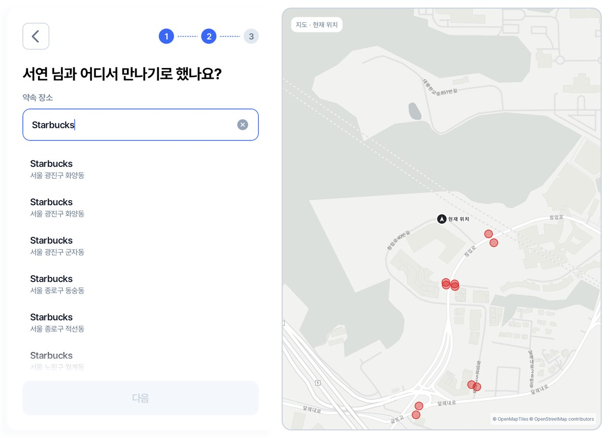
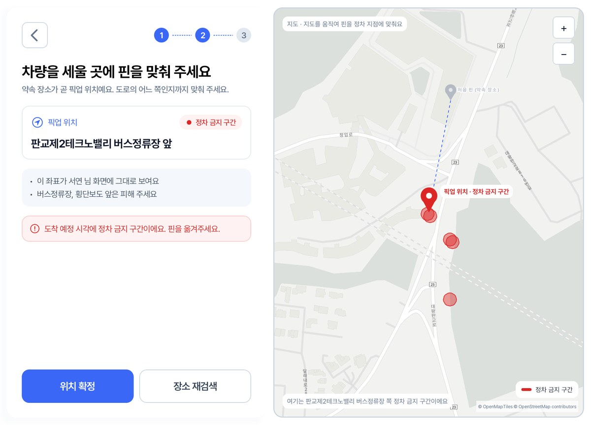
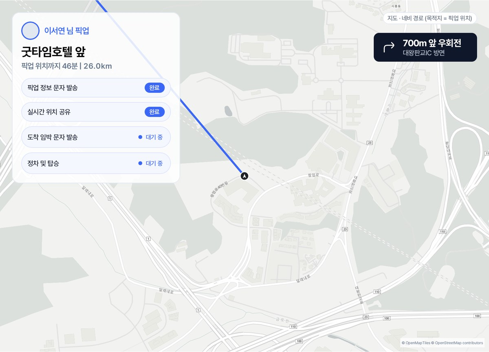
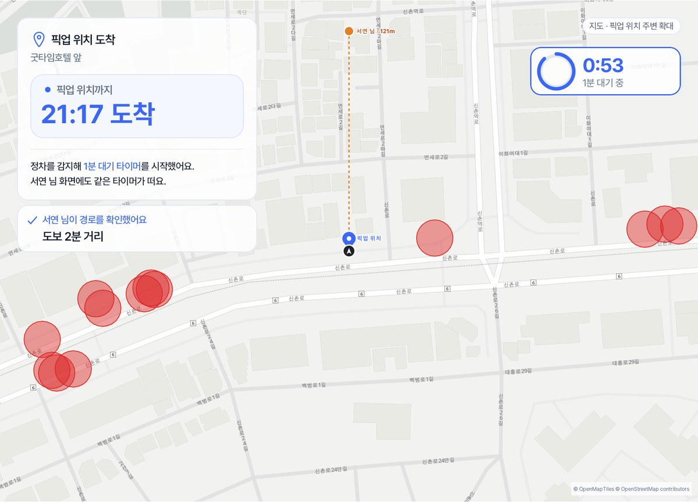
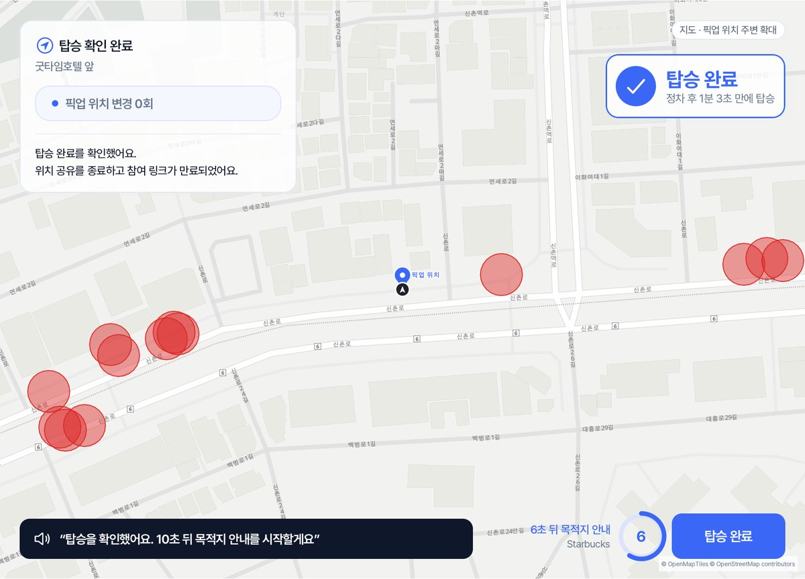
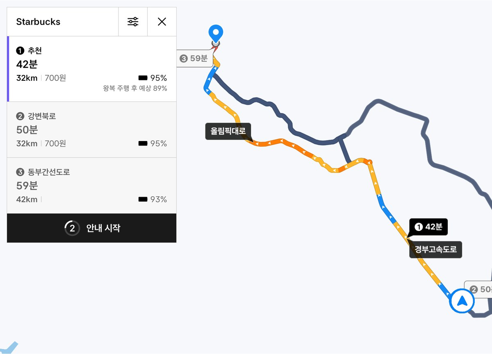
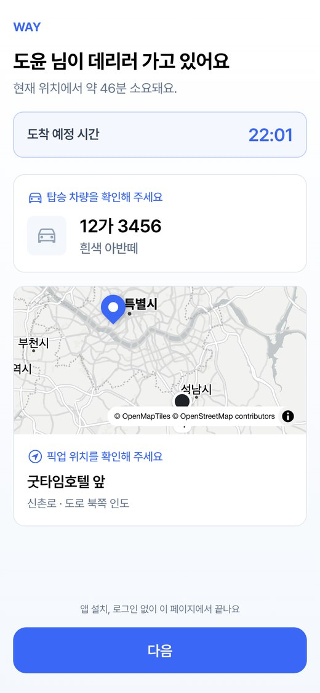
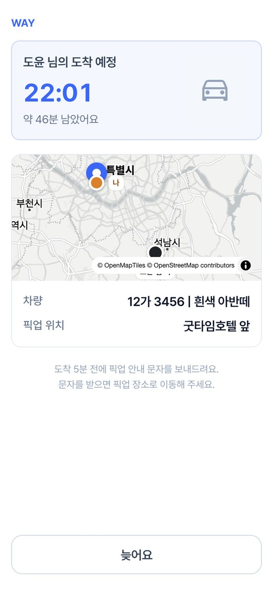
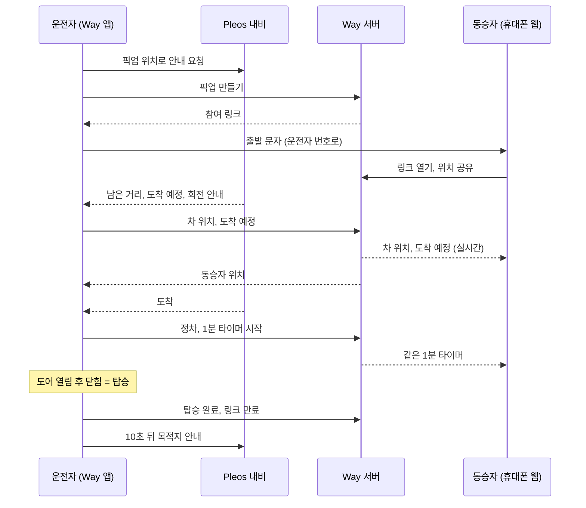

# WAY

운전자는 차 화면에서 동승자를 태울 자리를 도로의 어느 쪽 인도인지까지 정합니다. 동승자는 문자로 받은 링크 하나로 그 자리와 다가오는 차를 봅니다. Pleos Connect용 차량 앱이며, 현대자동차그룹 차량용 앱 개발 공모전 출품작입니다.


<sub>차가 서면 운전자 화면(왼쪽)과 동승자 휴대폰(오른쪽)에 같은 1분 타이머가 뜹니다. 동승자는 앱을 깔지 않습니다.</sub>

## 무엇을 해결하나요

픽업할 때마다 "어디쯤이야?", "길 건너편이야?" 하는 통화가 오갑니다. WAY는 약속 장소를 핀으로 정하고, 동승자 화면에도 같은 좌표를 그대로 보여 줍니다. 차가 서면 1분 대기 타이머가 양쪽에서 함께 돕니다. 1분은 불법 주정차 단속의 예외 시간입니다. 문이 열렸다 닫히면 탑승으로 보고 픽업을 끝냅니다. 운전 중에 화면을 만질 일은 음성 안내와 헤드업 알림으로 줄였습니다.

## 픽업 한 번의 흐름

화면 이름(D-01~D-10)은 피그마 와이어프레임 v2의 프레임 이름과 같습니다. 캡처는 모두 Pleos Connect 에뮬레이터에서 실제 데이터로 찍었습니다. 차량 번호만 시연용 값입니다.

### 출발 전

| D-01 홈 | D-02 누구를 태우러 가나요 |
|---|---|
|  |  |
| 최근 픽업을 누르면 같은 사람, 같은 장소로 바로 이어집니다. | 기기 연락처에서 고르며, 최근에 태운 사람이 먼저 나옵니다. |

| D-03 약속 장소 | D-04 핀 맞추기 |
|---|---|
|  |  |
| 앱 안에 넣은 장소 색인으로 찾습니다. 인터넷 지도 API를 부르지 않습니다. | 지도를 움직여 핀을 정차할 자리에 맞춥니다. 버스정류장 둘레에 걸리면 정차 금지 구간이라고 알려 줍니다. |

| D-05 픽업 후 목적지 | D-05 출발 확인 |
|---|---|
|  |  |
| 건너뛰어도 됩니다. 정해 두면 탑승한 뒤 그곳으로 안내합니다. | 동승자 번호는 가운데를 가립니다. 출발을 누르면 내비 안내가 시작되고 동승자에게 문자가 갑니다. |

### 가는 길



출발하면 Pleos 내비가 픽업 위치로 안내합니다. Way를 열면 왼쪽 위 카드에 남은 시간이 보이고, 그 옆 글자는 5초마다 남은 거리와 도착 예정 시각을 번갈아 보여 줍니다. 오른쪽 위에는 내비가 보내는 다음 회전 안내가 뜹니다. 아래 네 단계는 일이 일어날 때마다 완료로 바뀝니다.

동승자에게 가는 문자는 세 가지입니다. 출발할 때, 도착 5분 전, 도착 예정이 3분 넘게 바뀌었을 때입니다. 세 문자 모두 차에서 운전자 번호로 보냅니다(Pleos 메시지, 블루투스로 연결된 휴대폰). 서버는 동승자 번호를 받지 않습니다.

### 도착해서

| D-08 정차, 1분 대기 | D-09 15초 남았는데 아직 안 탐 |
|---|---|
|  |  |
| 내비가 도착을 알리면 타이머가 시작됩니다. 걸어오는 동승자의 위치와 거리가 지도에 보입니다. | "전화를 걸까요?" 하고 물어 '응'이라고 답하면 전화를 겁니다. 손으로 누르는 전화하기 버튼도 있습니다. |

| D-10 탑승 완료 | 10초 뒤 |
|---|---|
|  |  |
| 앞 오른쪽 문이 열렸다 닫히면 탑승으로 봅니다. 목적지를 정해 뒀으면 10초를 셉니다. 탑승 완료를 누르면 바로 넘어갑니다. | Pleos 내비가 목적지 경로를 띄웁니다. Way가 내비 뒤에 가려져 있어도 넘어갑니다. |

### 동승자 화면

동승자는 문자 속 링크를 엽니다. 설치도 로그인도 없이 휴대폰 브라우저에서 끝납니다.

<table>
  <tr>
    <td width="25%"></td>
    <td width="25%"></td>
    <td width="25%"></td>
    <td width="25%"></td>
  </tr>
  <tr>
    <td>누가 언제 오는지, 어떤 차를 타는지, 어디서 기다리는지 봅니다.</td>
    <td>위치를 공유할지 고릅니다. 허용하지 않아도 차 위치와 도착 예정 시각은 보입니다.</td>
    <td>차와 내 위치를 함께 봅니다. 늦으면 늦어요를 눌러 운전자에게 음성으로 알립니다.</td>
    <td>타면 위치 공유가 끝나고 링크는 만료됩니다.</td>
  </tr>
</table>

## 어떻게 이어지나요



정해 둔 것들입니다.

- **지도와 장소 검색은 앱 안에 둡니다.** 공모전에서 쓸 수 있는 Pleos SDK에 지도가 없어서 MapLibre에 오프라인 지도 파일(OpenStreetMap, `app/src/main/assets/map/way.pmtiles`)과 오프라인 장소 색인(`assets/places/way-places.dat`)을 넣었습니다. 실행 중 외부 지도 API를 부르지 않습니다. Pleos 내비게이션 SDK가 열리면 그쪽으로 옮길 계획입니다.
- **정차 금지 구간은 공공데이터로 판단합니다.** 국토교통부 전국 버스정류장 위치정보에서 수도권 74,726곳을 뽑아 정류장 둘레 10m를 금지 구간으로 봅니다. 서버가 구간을 내려 주고, 도착 예정 시각 기준의 판단은 앱이 합니다.
- **탑승은 도어 센서로 판정합니다.** Vehicle SDK로 앞 오른쪽 문이 열렸다 닫히는 것을 봅니다. 도어 정보를 쓸 수 없으면 화면 버튼이나 Gleo에게 "탑승 완료"라고 말해서 알립니다.
- **운전 중에는 Pleos 내비가 앞에 있습니다.** Way는 포그라운드 서비스로 살아 있으면서 음성 안내와 헤드업 알림으로 동작합니다. 탑승 뒤 10초 목적지 안내도 화면이 아니라 픽업 로직이 세므로 Way가 가려져 있어도 넘어갑니다.

## 구조

| 모듈 | 하는 일 |
|---|---|
| `:domain` | 순수 Kotlin. 픽업 규칙(`PickupRules`: 도착 5분 전 알림, 도착 예정 재안내, 1분 대기, 15초 남으면 전화 제안), 픽업 진행(`PickupCoordinator`), 정차 금지 판단 |
| `:data` | 서버 통신(OkHttp), 오프라인 장소 검색, 지난 픽업 기록(앱 파일) |
| `:app` | Compose 화면, Pleos 연동(NaviHelper, 도어 센서, STT/TTS, Gleo), 포그라운드 서비스, 기기 연락처, MapLibre 지도 |
| `:server` | Ktor. 픽업 세션과 참여 링크, 차와 동승자 웹을 잇는 WebSocket, 동승자 웹(`/p/{token}`), 정차 금지 구간 API |

## 실행하기

JDK 17과 Pleos Connect 에뮬레이터가 필요합니다. 에뮬레이터의 앱 사용자는 10번이라 `adb` 명령에 `--user 10`을 붙입니다.

```bash
./gradlew :app:assembleDebug
```

```bash
adb install -r app/build/outputs/apk/debug/app-debug.apk
```

16GB 맥에서 에뮬레이터를 켠 채 Gradle 데몬으로 빌드하면 에뮬레이터가 죽을 수 있습니다. 그럴 땐 `--no-daemon -Pkotlin.compiler.execution.strategy=in-process`를 붙입니다.

시연할 때 쓰는 스위치는 `app/src/main/java/com/kscho/way/di/WayConfig.kt`에 있습니다.

| 값 | 뜻 |
|---|---|
| `SERVER_URL` | Way 서버 주소. 지금은 임시 서버 `https://way.posktop.duckdns.org`, 로컬 서버는 `http://10.0.2.2:8080`, `null`이면 앱 안 mock 서버 |
| `SIMULATED_DRIVE` | `true`면 Pleos 내비 대신 20배속 모의 주행이라 D-06~D-10이 Way 화면에 그대로 보입니다 |
| `TEXTS_VIA_PLEOS` | `false`면 문자 화면을 띄우지 않고 로그(`WayText`)만 남깁니다. 휴대폰을 연결할 수 없는 에뮬레이터에서 화면을 녹화할 때 씁니다 |
| `DEMO_HISTORY` | `true`면 처음 설치할 때 지난 픽업 두 건을 넣어 둡니다 |

디버그 빌드에서는 화면을 거치지 않고 픽업을 움직일 수 있습니다.

```bash
adb shell am broadcast --user 10 -a com.kscho.way.debug.START_MOCK_PICKUP -p com.kscho.way
```

```bash
adb shell am broadcast --user 10 -a com.kscho.way.debug.ARRIVE -p com.kscho.way
```

```bash
adb shell am broadcast --user 10 -a com.kscho.way.debug.BOARD -p com.kscho.way
```

```bash
adb shell am broadcast --user 10 -a com.kscho.way.debug.CLEAR_PICKUP -p com.kscho.way
```

차례대로 출발, 정차, 탑승, 픽업 지우기입니다. 실제 도어로 시험하려면 에뮬레이터 Virtual Console(`adb forward tcp:8088 tcp:8088` 뒤 http://127.0.0.1:8088)에서 앞 오른쪽 문을 열었다 닫습니다.

### 서버

```bash
./gradlew :server:installDist
```

```bash
WAY_MAP_DIR=app/src/main/assets/map server/build/install/server/bin/server
```

`WAY_MAP_DIR`는 동승자 웹이 앱과 같은 오프라인 지도를 쓰게 합니다. 서버는 8080 포트로 뜨며, 앱의 `SERVER_URL`을 `http://10.0.2.2:8080`으로 바꾸면 에뮬레이터 앱이 붙습니다. 동승자 웹 주소 끝에 `?demo`를 붙이면 휴대폰 없이 가상 위치로 걸어오는 동승자를 흉내 냅니다. 운영에서는 `WAY_DEV_ROUTES=0`으로 개발용 경로를 끕니다. 임시 서버에 올리는 방법은 [deploy/lightsail/README.md](deploy/lightsail/README.md)에 있습니다.

### 테스트

```bash
./gradlew :domain:test :data:test :server:test :app:testDebugUnitTest
```

## 데이터와 라이선스

- 지도: © OpenMapTiles © OpenStreetMap contributors (ODbL). 타일은 OpenFreeMap에서 한 번 받아 `tools/map/build_offline_map.py`로 만듭니다.
- 장소 색인: OpenStreetMap, `tools/map/build_places_index.py`
- 버스정류장: 국토교통부 전국 버스정류장 위치정보(공공데이터포털 15067528, 이용허락범위 제한 없음), `tools/data/build_bus_stops.py`
- 글꼴: Pretendard (SIL Open Font License, `app/src/main/assets/licenses/Pretendard-OFL.txt`)
- 지도 그리기: MapLibre Native Android, MapLibre GL JS
